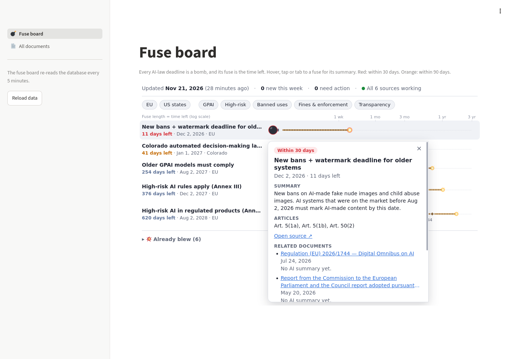
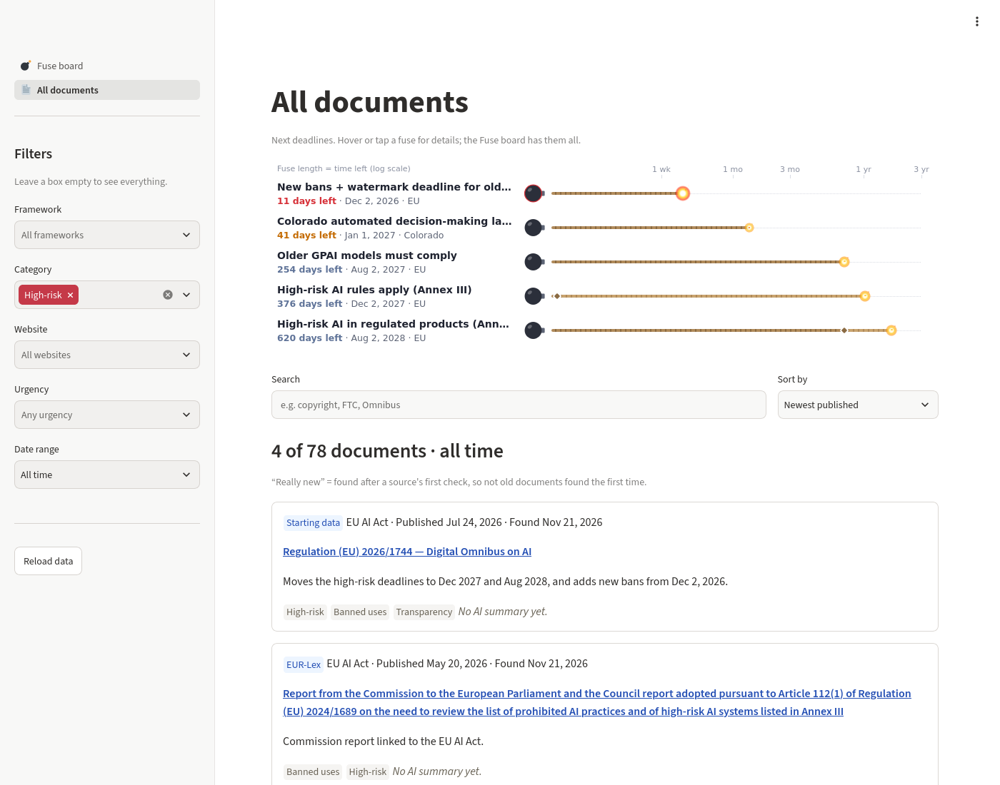
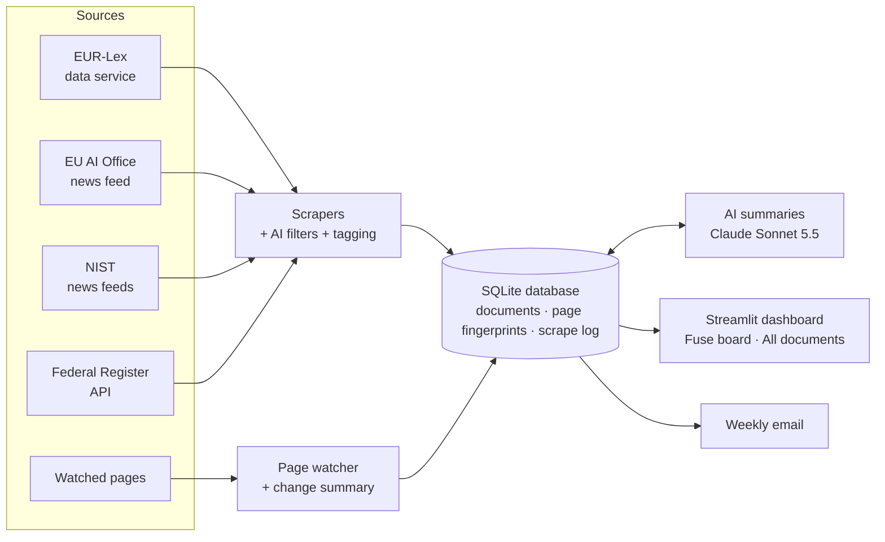

# AI Regulation Tracker

> Automatic monitoring of AI regulation across the EU and the US, with a dashboard that answers two questions first: **what's about to blow, and what changed this week?**

**Live dashboard:** https://YOUR-APP.streamlit.app <!-- TODO: replace with the real address after the first Streamlit Cloud deploy -->
· **Updates itself every Monday**, no computer of yours needs to be on.



## Why this exists

AI rules change fast, and they don't come from one place. An EU guidance document lands on one website, a US executive order on another, and a deadline quietly moves in a third. Compliance teams can't check every source every day, and when one is missed, the gap usually shows up at the worst time.

This tracker watches the official sources for you. It collects new laws, guidance and enforcement actions, notices when a law's text or a key page changes, and shows everything in a dashboard a non-specialist can read in two minutes. It's built with **general-purpose AI (GPAI) providers** in mind: companies that build or offer large AI models and fall under the EU AI Act's GPAI rules.

## What it tracks

| Source | What it watches | How |
|---|---|---|
| **EUR-Lex** (EU law) | Amendments, corrections, implementing rules and reports linked to the EU AI Act, plus new full-text versions of the Act | The EU Publications Office's official data service (SPARQL) |
| **EU AI Office** | Guidance, standards and consultations about the AI Act | The site's official news feed (RSS) |
| **NIST** | AI Risk Management Framework updates, model evaluations, AI guidance | NIST's topic news feeds (RSS) |
| **Federal Register** | White House AI executive orders, and agency AI rules and notices (FTC, Commerce, and others) | The Federal Register's official API |
| **Watched pages** | The NIST AI RMF page, the AI RMF Playbook, and the Colorado SB 26-189 bill page | A fingerprint of each page, compared on every run |

The database starts with **14 hand-checked documents** (the AI Act, the GPAI Code of Practice and guidelines, NIST's AI RMF and Generative AI Profile, key executive orders, and the California and Colorado laws). On its first run it finds about **60 more** on its own.

## What it does

- **Summarizes every document in plain English** with Claude Sonnet 5.5: a 3-bullet summary, who's affected, the key deadline, actions to take, and an urgency level (🔴 Action Required, 🟡 Watch, ⚪ Informational). Each document is summarized once and saved, so the cost stays at cents a month.
- **Emails a weekly update** of what's new, with the summaries and the most urgent items first.
- **Finds new documents automatically**, from official sources only.
- **Spots changes, not just new items.** For example, when a watched page changes, it saves an update that quotes the new text, and when the EU publishes a new full-text version of the AI Act, it flags it.
- **Tells "really new" apart from "old but newly found".** The first time a source is checked, everything looks new. The tracker only counts later finds as news, so the weekly view stays honest.
- **Filters the noise.** A Federal Register search for "artificial intelligence" returns 450+ documents since 2025, and most only mention AI once. The tracker keeps the ~33 that are actually about AI, using rules tested against real documents.
- **Shows its own health.** Every run is logged. If a source fails, the dashboard says so, so "nothing new" never hides "something broke".
- **Shows every deadline as a lit fuse**, including the ones that moved, so the next thing about to land stands out.
- **Stays online and updates itself.** The dashboard is hosted for free on Streamlit Community Cloud, and a GitHub Actions job checks every source each Monday, then commits the updated database, which redeploys the site.

## The dashboard

**Fuse board** (home page): every deadline is a **bomb with a lit fuse**. The fuse is the time left, on a log scale capped at 3 years, so a deadline 2 weeks out and one 2 years out both read clearly.

- 🔴 **Within 30 days**: a red fuse with a fast, bright spark. 🟠 **Within 90 days**: orange. Later: gray-blue, with a slow spark.
- **Hover, tap or tab to a fuse** for its card: the date, days left, a plain-English summary, who's affected, what to do, the urgency, the articles, the source, and (for a law's milestones) the related documents with their AI summaries.
- **Moved deadlines get a spliced fuse.** A knot marks the old date, labeled e.g. "Extended +16 months by Reg. 2026/1744" (the EU's Digital Omnibus).
- **Documents with a deadline join the board.** If a document's AI summary has a key deadline still ahead, it gets its own fuse, marked "from a document".
- **Deadlines that have passed are exploded bombs**, in a collapsible "Already blew" row: "In force since Aug 2, 2025".
- A header strip shows when the sources were last checked, what's new this week, what needs action, and a health dot that turns red and names any failing source.
- Filter chips for EU / US / US states and for categories (GPAI, high-risk, banned uses, and more). It works in light and dark mode, on phones (fuses stack under their titles and a tap opens the card), with the keyboard, and with reduced motion (no spark animation).

**All documents:** the next 5 deadlines as a compact fuse strip, then every document in the database with its source (EUR-Lex, EU AI Office, NIST, Federal Register, a watched page, or the starting data), framework, categories, published and found dates, urgency, and a "Really new" marker. Open **Full AI summary** for the details. Filter by framework, category (GPAI, high-risk, banned uses, fines and enforcement, and more), website, urgency, date range and search, and sort by date, urgency or title. Filters can be set in the link, so a view can be shared: `/documents?category=gpai&urgency=Action Required&range=All time`. The website status table is at the bottom.



## GPAI focus

The EU AI Act has a separate chapter for general-purpose AI models. Since **Aug 2, 2025**, every GPAI provider must keep technical documentation, inform companies that build on its model, follow a copyright policy that respects opt-outs, and publish a training-data summary (Article 53). Models trained with more than 10²⁵ FLOPs are presumed to carry **systemic risk** (Article 51) and have extra duties: adversarial testing, risk mitigation, serious-incident reporting and cybersecurity (Article 55). Since **Aug 2, 2026**, the European Commission can fine GPAI providers directly, up to **€15M or 3%** of worldwide turnover (Article 101).

The dashboard's **GPAI** filter pulls out documents about these rules. A plain-English summary of the key articles is in [docs/TO_READ.md](docs/TO_READ.md).

## Facts are checked against the source

Every deadline and starting document links to its official source. Building this surfaced several commonly repeated "facts" that are now out of date:

- **The EU high-risk deadline is no longer Aug 2, 2026.** The Digital Omnibus on AI (Regulation (EU) 2026/1744) moved it to **Dec 2, 2027** (Annex III) and **Aug 2, 2028** (Annex I).
- **€35M / 7% is not the fine for everything.** It applies to banned practices only. GPAI fines are €15M / 3%.
- **The 10²⁵ FLOP threshold is in Article 51**, not Article 55.
- **Colorado's AI Act (SB 24-205) never took effect.** It was replaced by SB 26-189, with duties starting Jan 1, 2027.
- **The UK AI Safety Institute** is now the **AI Security Institute**.

Details are in [docs/day1_findings.md](docs/day1_findings.md).

## How it works



Every Monday at 07:00 UTC a **GitHub Actions** job runs `python main.py weekly --yes` (check every source, summarize what's new, email it) and commits the updated database. That push makes **Streamlit Community Cloud** redeploy the dashboard, so the live site always shows the latest data.

## Setup

You need [conda](https://docs.conda.io/) (or any Python 3.12 setup).

```bash
conda env create -f environment.yml    # makes the "regtracker" env and installs requirements.txt
conda activate regtracker

python main.py init-db    # create the database (data/tracker.db)
python main.py seed       # load the 14 starting documents
python main.py scrape     # check every source (about 30 seconds)

streamlit run dashboard/app.py --server.address localhost    # open http://localhost:8501
```

The repository already includes `data/tracker.db` (the hosted dashboard reads it), so you can skip the three `main.py` lines to just look at the latest data.

### AI summaries and email (optional)

Copy the settings file and fill in your keys. `.env` is on git's ignore list, so keys never get uploaded.

```bash
cp .env.example .env
code .env    # or any editor
```

| Setting | What it is |
|---|---|
| `ANTHROPIC_API_KEY` | Your Anthropic API key (for the summaries) |
| `SUMMARY_BUDGET_USD` | The most one `summarize` run may spend (default $1.50) |
| `SMTP_USER`, `SMTP_PASSWORD` | The Gmail address that sends the email, and a Gmail [app password](https://myaccount.google.com/apppasswords) |
| `ALERT_TO` | Who gets the email (comma-separated) |

Then:

```bash
python main.py summarize --dry-run    # see the cost first (spends nothing)
python main.py summarize              # shows the estimate and asks before spending
python main.py digest --test          # send yourself a test email
```

### Commands

| Command | What it does | Costs money? |
|---|---|---|
| `python main.py scrape` | Check every source and watched page | No |
| `python main.py scrape --source nist` | Check one source (`eurlex`, `eurlex_versions`, `eu_ai_office`, `nist`, `federal_register`, `pages`) | No |
| `python main.py summarize --dry-run` | Show what summaries would cost | No |
| `python main.py summarize` | Summarize every document that doesn't have a summary yet (asks first) | Yes, cents |
| `python main.py summarize --redo "Action Required"` | Re-summarize documents with one urgency level, e.g. after changing the instructions | Yes, cents |
| `python main.py digest` | Email what's new since the last email (`--preview` to just print it) | No |
| `python main.py weekly --yes` | Scrape, summarize what's new, and email it. The one command the weekly job runs. Without `--yes` it asks before spending (unless there's no terminal to ask, like in a scheduled job). The spending cap always applies. | Only for new items |
| `python main.py new` | List what's really new (last 7 days; `--days 30` for more) | No |
| `python main.py list` | List the latest documents | No |
| `python main.py runs` | Show the scrape log, including any errors | No |

### What the summaries cost

Each document is summarized **once** and saved. It's only redone if its text changes. A typical document costs about 1–2 cents with Claude Sonnet 5.5, and summarizing all ~70 existing documents costs about $1.50. After that, only new documents cost anything, which comes to cents a month. Every run shows an estimate first, has a spending cap, and skips whole-law documents over 40,000 tokens unless you ask for them (`--include-large`).

## Always online, updated weekly

### The live dashboard (Streamlit Community Cloud, free)

Set up once, by hand:

1. Go to [share.streamlit.io](https://share.streamlit.io) and sign in with GitHub.
2. **Create app** → repository `Omar-A-Abaza/regulation_tracker`, branch `master`, main file `dashboard/app.py`.
3. Optional: pick a custom address under *Advanced settings*. Then put the address at the top of this README.

The dashboard only reads the database, so it needs no secrets. (If you ever add some, put them in the app's *Secrets* box; the dashboard reads them like `.env`.) It redeploys on every push to `master`, including the weekly update.

Free apps go to sleep after a few days with no visitors. The next visitor clicks the wake-up button and waits about 30 seconds. The data is unchanged.

### The weekly update (GitHub Actions)

[`.github/workflows/weekly.yml`](.github/workflows/weekly.yml) runs every **Monday at 07:00 UTC**. It needs four repository secrets, set once:

```bash
gh secret set ANTHROPIC_API_KEY
gh secret set SMTP_USER
gh secret set SMTP_PASSWORD
gh secret set ALERT_TO
```

**Run it by hand:** on GitHub, open **Actions → Weekly update → Run workflow**, or from a terminal:

```bash
gh workflow run weekly.yml                                  # the normal weekly run
gh workflow run weekly.yml -f summarize_backlog=true        # also summarize older documents (spending cap applies)
gh run watch                                                # follow it
```

The job fails (and GitHub emails you) only if **every** source failed, or the summaries or the email failed. If just some sources fail, it carries on; the failure is in the scrape log and the dashboard's health dot turns red. The database is committed either way, so nothing found is lost.

**Optional backup on your own computer** (off by default), e.g. with `crontab -e`:

```
0 8 * * 1  cd /path/to/regulation_tracker && ~/miniforge3/envs/regtracker/bin/python main.py weekly --yes >> weekly.log 2>&1
```

Only use one of the two at a time, or the database in the repository and the one on your computer will drift apart.

## Project structure

```
scrapers/      one file per source, plus shared tools (polite HTTP client, RSS reader)
processors/    AI summaries (summarizer.py), full text (fulltext.py), tagging, change summaries
notifications/ the update email (email_digest.py)
database/      the 3 tables and the helper functions everything uses
dashboard/     the Streamlit app: the Fuse board and All documents pages, data loading, and the fuse view (fuse.py + static/fuse.html)
data/          the timeline, the starting documents, and the list of watched pages
tests/         130 automated tests, using saved copies of real responses, a fake AI and a fake mail server
docs/          build notes, the fact check, and the AI Act summary
main.py        the commands above
.github/       the weekly GitHub Actions job
```

## Testing

```bash
pytest
```

The tests run offline, against saved copies of real responses from each source. They cover the parsers, the AI filters, de-duplication, change detection, the "really new" logic, the scrape log, the summarizer and its money safety rails (with a fake AI, so tests never spend credit), the update email (with a fake mail server), the weekly job and its `--yes` flag, the fuse board's data (log-scale fuse length, urgency buckets, exploded and moved deadlines, document deadlines), and both dashboard pages end to end.

## Design choices

- **Official channels first.** Each source is read through its API, data service or news feed where one exists, so nothing depends on a fragile page layout.
- **Polite, and no getting around blocks.** Requests are rate-limited and identify the tracker, and every address it uses was checked by hand against that site's robots.txt rules. When a site blocks automated access (like the California legislature's bill pages), it's left out rather than worked around.
- **Every number has a source.** Deadlines and starting documents are hand-checked against the official text and link to it.
- **Honest empty states.** "Nothing new" is only shown when every source was checked successfully.

## Limitations and roadmap

**Not built yet:**
- **A cross-framework map** linking EU AI Act articles to NIST AI RMF and ISO/IEC 42001.
- **A GPAI compliance checklist** and a 10²⁵ FLOP threshold calculator.
- **An enforcement tracker** (fines and investigations under AI laws).
- **More sources:** the UK AI Security Institute, the FTC, state legislatures, and the OECD.

**Known limits:**
- **The EU AI Office feed only holds its 10 newest items**, so the tracker needs to run at least every week or two not to miss any.
- **Some documents can't be fetched in full** (EU AI Office pages block programs, a few EU corrections have no text version, NIST's frameworks are PDFs). Their summaries are written from the title and description, and say so.
- **Until a document is summarized, its tags come from keyword matching**, which is rougher.
- **California's bill pages are behind a bot check**, so SB 53 is tracked through the starting data only.
- **The free hosted dashboard sleeps** after a few days without visitors; the first visit after that takes about 30 seconds.

## Disclaimer

This is a monitoring tool, not legal advice. The summaries are written by AI and can be wrong. Always check the official source before acting on anything it shows.
